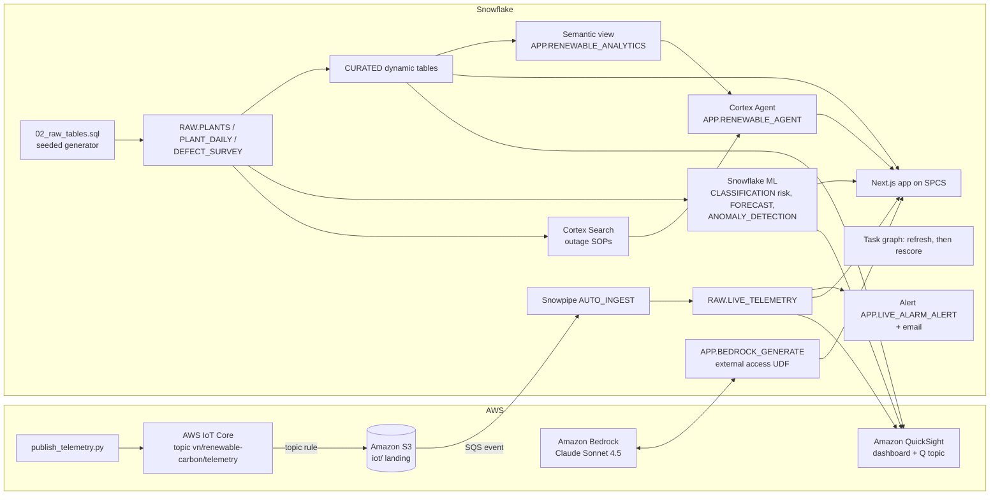

# Vietnam Renewable Generation and Avoided Emissions - Solar, Wind and Small Hydro Plants

Plant operations and estimated avoided emissions for **30 plants of a fictional renewable power producer across 4 Vietnamese cities** (Phan Rang-Thap Cham, Phan Thiet, Bac Lieu, Quy Nhon) using Snowflake, optionally with AWS: from a live SCADA equipment-temperature alarm to a 7-day forced-outage risk score, an alarm email and an AI action memo. The producer, its plants and all data are synthetic; nothing here describes the performance of any real company or site. Avoided emissions are estimates from an internal demo emission factor; they are not verified, certified or carbon-credit figures.

## Architecture

A renewable plant operations pipeline built on **Snowflake** (Dynamic Tables, Snowflake ML, Cortex Search, Cortex Agent, Cortex AI_COMPLETE, SPCS) and, in the full build, **AWS** (IoT Core, S3, Bedrock Claude, QuickSight + Amazon Q). Plant SCADA telemetry lands in `RAW.LIVE_TELEMETRY`. Dynamic tables curate 90 days of plant-day history: meter intervals passing a data-quality check, forced generation outages, generation in MWh, estimated avoided CO2e, community grievances, plant availability and inspection-survey defect closure. Snowflake ML scores 7-day outage risk per plant, forecasts portfolio-wide daily estimated avoided CO2e and flags power-conversion equipment temperature anomalies. A Cortex Agent answers questions with SOP citations, and an LLM drafts the operations action memo.

Interactive diagrams (hover for object names): [Snowflake only](docs/architecture-snowflake.html) | [AWS + Snowflake](docs/architecture-aws.html). The app shows both on its Architecture & Data tab, the current build first. Regenerate them with `python3 docs/build_architecture.py`.



The Snowflake-only build drops the AWS subgraph: `APP.SIMULATE_TELEMETRY` writes to `RAW.LIVE_TELEMETRY`, and the app calls Cortex `AI_COMPLETE` instead of the Bedrock UDF.

## Snowflake Capabilities

| Capability | Implementation |
|-----------|---------------|
| Dynamic Tables | `CURATED.KPI_SUMMARY`, `PERFORMANCE_SUMMARY`, `OUTAGE_CAUSES`, `TREND_ANALYSIS` from the RAW tables |
| Snowflake ML | CLASSIFICATION 7-day forced-outage risk (`ML.OUTAGE_RISK_SCORES`), 14-day estimated avoided CO2e FORECAST, equipment temperature ANOMALY_DETECTION |
| Cortex Search | 21 synthetic outage-response SOPs (one per plant type and cause) in `SEARCH.OUTAGE_SOP_SEARCH` |
| Semantic View | `APP.RENEWABLE_ANALYTICS` over plants, outage causes, daily totals and risk |
| Cortex Agent | `APP.RENEWABLE_AGENT`: Cortex Analyst over the semantic view plus Cortex Search for SOP citations |
| Cortex AI | `AI_COMPLETE('claude-sonnet-4-5')` for grounded answers, and for the action memo in the Snowflake-only build |
| Alerts + Tasks | `APP.LIVE_ALARM_ALERT` logs ALARM readings and sends email; task graph `TASK_REFRESH_CURATED`, then `TASK_RESCORE_RISK` |
| Snowpark Container Services | Next.js app `APP.VN_RENEWABLE_CARBON_APP` with 6 tabs: Executive Cockpit, Predictive, Plant Health, Live IoT, Ask AI, Architecture & Data |
| Snowpipe | `RAW.LIVE_TELEMETRY_PIPE` AUTO_INGEST from S3 (AWS build only) |

## AWS Services

Used only in the AWS + Snowflake build.

| Service | Role in Demo |
|---------|-------------|
| AWS IoT Core | Receives simulated plant SCADA telemetry (power-conversion equipment temperature, output). A topic rule writes each message to S3 |
| Amazon S3 | Landing bucket. An event notification goes to the Snowpipe SQS queue |
| Amazon Bedrock | Claude Sonnet 4.5 writes the action memo, called from Snowflake through an external-access UDF |
| Amazon QuickSight | DIRECT_QUERY executive dashboard over Snowflake (daily meter data valid, outages by plant, outage risk) |
| Amazon Q | Natural-language questions over the QuickSight topic `vn-renewable-carbon-topic` |
| AWS IAM | Least-privilege roles for S3, IoT and Bedrock |

## Personas

These personas are fictional.

| Persona | Role | Key Questions |
|---------|------|---------------|
| **Pham Thi Thu Ha** | Head of Renewable Operations | "Which region has the lowest plant availability?" "Which outage causes leave the most meter intervals invalid?" |
| **Nguyen Duc Minh** | Plant Performance Engineer | "Which plants are high outage risk this week, and which SOP applies?" |

## Data

All data is synthetic and seeded, so every rebuild reproduces it. The producer and plant names are fictional; the four cities are real Vietnamese places used only as region labels. The emission factor is an internal demo factor, not an official grid emission factor, and no figure is a verified emissions result or a carbon credit.

| Table | Rows | Description |
|-------|------|-------------|
| RAW.PLANTS | 30 | Plants across 4 regions and 5 plant types (Utility Solar, Rooftop Solar, Onshore Wind, Nearshore Wind, Small Hydro) |
| RAW.PLANT_DAILY | 2,700 | Daily plant observations over 90 days: 15-minute meter intervals and intervals passing the data-quality check, generation (MWh), estimated avoided t CO2e, grievances, outages, root cause, preventive inspections, outage hours, equipment temperature and output |
| RAW.DEFECT_SURVEY | 30 | Defects found in the latest thermography or drone survey, defects closed and defects scheduled per plant |
| SEARCH.OUTAGE_SOP_DOCS | 21 | Synthetic outage-response SOPs indexed for Cortex Search |
| RAW.LIVE_TELEMETRY | Grows during the demo | Live readings from IoT Core (AWS build) or `APP.SIMULATE_TELEMETRY` (Snowflake-only build) |
| ML.OUTAGE_RISK_SCORES | 30 | 7-day outage probability and risk band per plant |

## Build Instructions

### Prerequisites
- Snowflake account with ACCOUNTADMIN access, and Cortex AI enabled (AI_COMPLETE, Search, Agent).
- An X-Small warehouse with auto-suspend at or below 120 s, and an existing SPCS compute pool.
- Python 3.11+, `snowflake-connector-python`, Node.js 22+, Docker and the `snow` CLI.
- App image: run `snow spcs image-registry login`, then build and push `vn-renewable-carbon-app:v1` to the database's `APP.IMAGES` repository (see the header of `snowflake/07_deploy_app.sql`).
- AWS build only: `boto3`, AWS credentials for the target account (us-west-2) with Bedrock access, and QuickSight Enterprise.

### SPCS App
```
<DATABASE>.APP.VN_RENEWABLE_CARBON_APP
```

### Tests
```bash
python -m pytest aws snowflake quicksight
```

For a local run, put `SNOWFLAKE_ACCOUNT`, `SNOWFLAKE_USER`, `SNOWFLAKE_DATABASE`, `SNOWFLAKE_WAREHOUSE`, `SNOWFLAKE_AUTHENTICATOR=PROGRAMMATIC_ACCESS_TOKEN`, `SNOWFLAKE_TOKEN` and `DEMO_PLATFORM` in the environment, then run `npm --prefix app run build && npm --prefix app start`.

## Build Modes

Both modes share the same core. They differ in three places, and the app's `DEMO_PLATFORM` setting (in its SPCS spec) switches the memo provider and the Live IoT tab.

| Layer | Snowflake Only | Full AWS + Snowflake |
|---|---|---|
| Live telemetry | `CALL APP.SIMULATE_TELEMETRY(n)` inserts simulated readings into `RAW.LIVE_TELEMETRY`. This simulates a sensor feed; it is not Snowpipe Streaming | `aws/publish_telemetry.py` to AWS IoT Core, then S3, SQS and Snowpipe AUTO_INGEST |
| Action memo | Cortex `AI_COMPLETE('claude-sonnet-4-5')` | Amazon Bedrock Claude Sonnet 4.5 through `APP.BEDROCK_GENERATE` |
| BI and natural-language questions | The SPCS app is the dashboard; questions go to the Cortex Agent | Also a QuickSight dashboard and an Amazon Q topic |
| App setting | `DEMO_PLATFORM: snowflake` | `DEMO_PLATFORM: aws` |

### Snowflake Only

```bash
# 1. Core data and dynamic tables (guarded: new isolated database only)
python snowflake/run_core.py --database VIETNAM_RENEWABLE_CARBON_SNOWFLAKE --warehouse <XS_WAREHOUSE> --connection <CONNECTION> --apply
# 2. Native telemetry, ML, search, semantic view, agent, alert and task graph
python snowflake/run_intelligence.py --database VIETNAM_RENEWABLE_CARBON_SNOWFLAKE --platform snowflake --warehouse <XS_WAREHOUSE> --connection <CONNECTION> --alert-email you@example.com
# 3. App on SPCS with DEMO_PLATFORM=snowflake (push the image first)
python snowflake/run_intelligence.py --database VIETNAM_RENEWABLE_CARBON_SNOWFLAKE --platform snowflake --warehouse <XS_WAREHOUSE> --connection <CONNECTION> --alert-email you@example.com --files 07_deploy_app.sql --compute-pool <COMPUTE_POOL>
```

During the demo:
- Run `CALL APP.SIMULATE_TELEMETRY(20)` to add live readings. For a continuous feed, run `ALTER TASK APP.TASK_SIMULATE_TELEMETRY RESUME`, and `SUSPEND` it afterwards.
- Run `EXECUTE ALERT APP.LIVE_ALARM_ALERT` to raise the alarm email.
- Run `EXECUTE TASK APP.TASK_REFRESH_CURATED` to refresh the curated tables and rescore risk.

Afterwards, drop the database or run `ALTER SERVICE APP.VN_RENEWABLE_CARBON_APP SUSPEND`.

### Full AWS + Snowflake

```bash
# 1. Core data and dynamic tables (guarded: new isolated database only)
python snowflake/run_core.py --database VIETNAM_RENEWABLE_CARBON_AWS --warehouse <XS_WAREHOUSE> --connection <CONNECTION> --apply
# 2. AWS ingestion and Bedrock (dry run first, then --apply)
python aws/setup_aws.py --database VIETNAM_RENEWABLE_CARBON_AWS --account <AWS_ACCOUNT_ID> --connection <CONNECTION> --apply
# 3. ML, search, semantic view, agent, alert and task graph
python snowflake/run_intelligence.py --database VIETNAM_RENEWABLE_CARBON_AWS --platform aws --warehouse <XS_WAREHOUSE> --connection <CONNECTION> --alert-email you@example.com
# 4. App on SPCS with DEMO_PLATFORM=aws (push the image first)
python snowflake/run_intelligence.py --database VIETNAM_RENEWABLE_CARBON_AWS --platform aws --warehouse <XS_WAREHOUSE> --connection <CONNECTION> --alert-email you@example.com --files 07_deploy_app.sql --compute-pool <COMPUTE_POOL>
# 5. QuickSight dashboard and Q topic (needs an existing Snowflake data source)
python quicksight/build_dashboards.py --database VIETNAM_RENEWABLE_CARBON_AWS --account <AWS_ACCOUNT_ID> --principal-arn <QUICKSIGHT_USER_ARN> --data-source-arn <DATA_SOURCE_ARN> --prefix vn-renewable-carbon --apply --update --with-topic
```

QuickSight objects must be shared with the QuickSight user who signs in (`--principal-arn`); otherwise the console shows nothing.

During the demo:
- Run `python aws/publish_telemetry.py --count 20` to send live readings.
- Run `EXECUTE ALERT APP.LIVE_ALARM_ALERT` to raise the alarm email.
- Run `EXECUTE TASK APP.TASK_REFRESH_CURATED` to refresh the curated tables and rescore risk.

Afterwards, `python aws/teardown_aws.py --database VIETNAM_RENEWABLE_CARBON_AWS --account <AWS_ACCOUNT_ID> --connection <CONNECTION> --apply` removes the AWS resources and the account-level Bedrock external-access and S3 storage integrations. It leaves the email integration `VN_RENEWABLE_CARBON_EMAIL_INT`, which the Snowflake-only build also uses.

## Business Impact

Industry research and a Snowflake customer story:
- **Solar and wind dominate new renewable capacity**: "Solar PV and wind together account for 95% of all renewable capacity growth through the end of this decade" -- [IEA, Renewables 2024: Executive summary](https://www.iea.org/reports/renewables-2024/executive-summary)
- **Renewables approach half of global electricity**: "In our main case, renewables will account for almost half of global electricity generation by 2030, with the share of wind and solar PV doubling to 30%." -- [IEA, Renewables 2024: Executive summary](https://www.iea.org/reports/renewables-2024/executive-summary)
- **Variable generation needs operational visibility**: "Increasing wind and solar PV generation is leading to higher curtailment, underlining the growing need for flexibility." -- [IEA, Renewables 2024: Executive summary](https://www.iea.org/reports/renewables-2024/executive-summary)
- **Uniper** (Snowflake customer, energy): "These agents combine data about safety instructions, security concerns, failure incidents, market prices and maintenance schedules to identify the optimal times to conduct maintenance activities and suggest operational changes." -- [Snowflake customer story: Uniper](https://www.snowflake.com/en/customers/all-customers/case-study/uniper/)

## Key Demo Numbers

These figures are synthetic and come from the seeded demo data. Forecast and anomaly figures can shift slightly with the build day.

- **30 plants**, 2,700 plant-days over 90 days, across 4 regions and 5 plant types; **883,921 MWh** generated and **259,200 meter intervals**
- **Meter data valid 93.4%**; per-plant values range from 89.6% to 95.9%, and Phan Thiet is the lowest region at 92.2%
- **370 generation outages** across 13 root causes; governor faults leave the most meter intervals invalid (772); PL-0024 has the most outages (48)
- **Estimated avoided emissions 566.0 kt CO2e** from 883.9 GWh, an average internal demo factor of 640.3 kg CO2e/MWh; nearshore wind generates the most (371.5 GWh)
- **Outage-risk model** out-of-time holdout: precision 0.54, recall 0.55 at a 0.5 threshold, against a 0.43 base rate (442 plant-days). 15 plants are high risk; the top plant is PL-0024, at 99.8%
- **14-day estimated avoided CO2e forecast** with prediction intervals; **16 of 480** plant-days flagged as equipment temperature anomalies
- **Plant availability 97.6%** (Phan Thiet lowest at 95.9%), survey defects closed 67.9%, 68 community grievances
- **21 SOPs** indexed for Cortex Search and cited by ID in agent answers

## License

Apache 2.0 — See [LICENSE](LICENSE) for details.

This is a personal demo project and is not an official Snowflake offering. It comes with no support or warranty. The producer, plants and figures are synthetic and do not describe any real company or site. Avoided-emissions figures are illustrative estimates, not verified, certified or carbon-credit quantities. Industry statements cited are from publicly available third-party sources; they are context, not guarantees of results.
